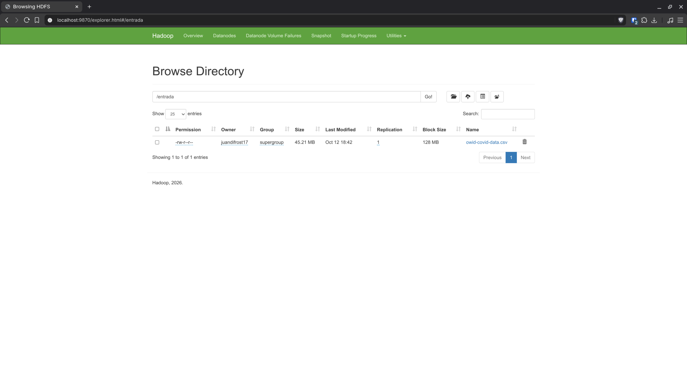
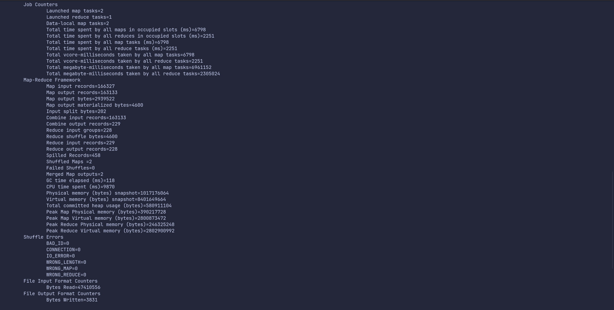
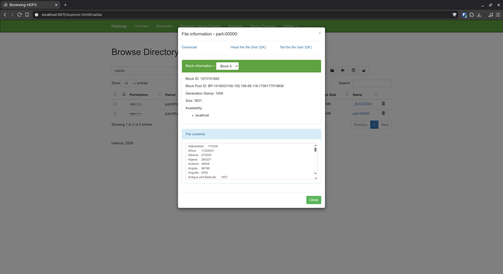

# Taller MapReduce: casos de COVID-19 por país

Programa en Hadoop MapReduce que calcula el número total de casos positivos de COVID-19 por país usando el dataset `owid-covid-data.csv` de Our World in Data.

## Dataset

El archivo tiene una fila por país y por día, con 67 columnas. Para este taller solo se usan dos:

| Columna     | Posición | Descripción                     |
|-------------|----------|---------------------------------|
| `location`  | 3        | Nombre del país                 |
| `new_cases` | 6        | Casos nuevos reportados ese día |

La idea es agrupar las filas por `location` y sumar todos los `new_cases` de cada país para obtener su total de casos.

## Estructura del proyecto

```
.
├── pom.xml                              # Dependencias de Hadoop 3.5.0
├── src/main/java/org/jdsotomayor/
│   ├── Covid_Mapper.java                # Emite (país, casos nuevos) por cada fila del CSV
│   ├── Covid_Reducer.java               # Suma los casos de cada país
│   └── Covid_Runner.java                # Configura y lanza el job
├── taller-mapreduce-pmdd.jar            # Jar compilado
├── entrada/owid-covid-data.csv          # Dataset que se sube a HDFS
├── resultado/part-00000.txt             # Salida del job
└── capturas/                            # Evidencia de la ejecución en HDFS
```

## Clases

### Covid_Mapper

Recibe cada línea del CSV y la separa por comas. Se salta el encabezado (la línea que empieza en el byte 0 del archivo) y las filas donde `new_cases` está vacío, que son los días sin casos reportados.

Como el dataset trae los casos con formato decimal (`5.0`), el valor se lee como `double` y se redondea antes de emitirlo:

```java
String[] fields = value.toString().split(",", -1);
...
country.set(fields[LOCATION]);
cases.set(Math.round(Double.parseDouble(fields[NEW_CASES])));
output.collect(country, cases);
```

### Covid_Reducer

Suma todos los valores que llegan para un mismo país. Se usa `long` en lugar de `int` porque algunos totales son bastante grandes, por ejemplo el de World pasa de 400 millones.

```java
long sum = 0;
while (values.hasNext()){
    sum+=values.next().get();
}
output.collect(key, new LongWritable(sum));
```

### Covid_Runner

Configura el job con `Text` como clave (país) y `LongWritable` como valor (casos). El reducer también se usa como combiner, así cada mapper adelanta sumas parciales antes de enviar los datos al reducer.

## Ejecución

```bash
# Compilar
mvn clean package
cp target/taller-mapreduce-pmdd-1.0-SNAPSHOT.jar taller-mapreduce-pmdd.jar

# Subir el dataset a HDFS
hdfs dfs -mkdir -p /entrada
hdfs dfs -put entrada/owid-covid-data.csv /entrada

# Ejecutar el job
hadoop jar taller-mapreduce-pmdd.jar org.jdsotomayor.Covid_Runner /entrada /salida

# Descargar el resultado
hdfs dfs -get /salida/part-00000 resultado/part-00000.txt
```

## Resultado

La salida completa está en [`resultado/part-00000.txt`](resultado/part-00000.txt). Cada línea tiene el país y su total de casos separados por un tabulador:

```
Afghanistan	174339
Africa	11254551
Albania	272030
Algeria	265227
Andorra	38434
...
```

Además de los países, el dataset incluye filas que agrupan regiones o niveles de ingreso (World, Africa, Europe, European Union, High income, etc.), y estas también aparecen en el resultado con su propio total.

### Países con más casos

| #  | País           | Casos totales |
|----|----------------|--------------:|
| 1  | United States  |    79,265,725 |
| 2  | India          |    42,962,953 |
| 3  | Brazil         |    28,935,718 |
| 4  | France         |    23,488,526 |
| 5  | United Kingdom |    18,331,636 |
| 6  | Russia         |    16,619,507 |
| 7  | Germany        |    15,831,207 |
| 8  | Turkey         |    13,502,992 |
| 9  | Italy          |    12,990,371 |
| 10 | Spain          |    11,185,264 |

## Evidencia

Dataset cargado en HDFS, en el directorio `/entrada`:



Contadores del job al terminar la ejecución. Se leen 166,327 líneas del CSV (`Map input records`), el mapper emite 163,133 pares país-casos (las filas restantes son el encabezado y los días sin `new_cases`) y el reducer escribe 228 líneas (`Reduce output records`), una por cada ubicación:



Vista del archivo `part-00000` desde el explorador de HDFS:



## Validación

Para comprobar el resultado, se sumó `new_cases` por país directamente sobre el CSV con `awk`, sin pasar por Hadoop:

```bash
awk -F, 'NR>1 && $6!="" {s[$3]+=$6} END {for (k in s) printf "%s\t%d\n", k, s[k]}' entrada/owid-covid-data.csv | sort
```

Las 228 líneas coinciden exactamente con la salida del job.

### Diferencia con la columna `total_cases`

El dataset también trae la columna `total_cases`, que es el acumulado de casos de cada país. Al comparar el último valor de esa columna con la suma de `new_cases`, en 148 de las 228 ubicaciones los números son iguales, pero en el resto hay diferencias:

| País           | Suma de `new_cases` | Último `total_cases` | Diferencia |
|----------------|--------------------:|---------------------:|-----------:|
| India          |          42,962,953 |           42,962,953 |          0 |
| United States  |          79,265,725 |           79,265,726 |         -1 |
| Brazil         |          28,935,718 |           29,040,800 |   -105,082 |
| France         |          23,488,526 |           23,064,766 |   +423,760 |
| Turkey         |          13,502,992 |           14,326,217 |   -823,225 |
| Ecuador        |             847,689 |              836,216 |    +11,473 |

Ninguna de estas diferencias viene del programa. Revisando el CSV día por día, todas se explican por alguna de estas situaciones del propio dataset:

1. **Ajustes en `total_cases` con `new_cases` vacío** (64 países). Hay días en los que el acumulado sube o baja por correcciones en las cifras del país, pero ese día `new_cases` no tiene valor, así que el ajuste no entra en la suma.
2. **Casos anteriores al inicio del registro** (Japan, Macao, South Korea y United States). El primer día del dataset ya trae casos en `total_cases`, pero `new_cases` está vacío. Por eso Estados Unidos queda 1 caso por debajo.
3. **Filas agregadas** (World, continentes y niveles de ingreso). Our World in Data calcula estas filas por separado, y su `total_cases` no siempre coincide con la suma de sus `new_cases`.

Ecuador es un ejemplo del primer caso. En todo su historial hay solo 5 días donde el cambio de `total_cases` no coincide con `new_cases`, y en los 5 el acumulado baja mientras `new_cases` está vacío:

| Fecha      | `total_cases`        | Cambio | `new_cases` |
|------------|----------------------|-------:|-------------|
| 2020-05-07 | 31,881 → 30,298      | -1,583 | vacío       |
| 2020-05-08 | 30,298 → 28,818      | -1,480 | vacío       |
| 2020-05-11 | 29,559 → 29,509      |    -50 | vacío       |
| 2020-09-07 | 118,045 → 110,092    | -7,953 | vacío       |
| 2021-11-11 | 519,967 → 519,560    |   -407 | vacío       |

Esas bajadas suman 11,473 (1,583 + 1,480 + 50 + 7,953 + 407), que es exactamente la diferencia entre la suma de `new_cases` (847,689) y el último `total_cases` (836,216).

Turquía es el caso contrario: el 2020-12-10 su acumulado sube de 925,342 a 1,748,567 (+823,225) en un solo día, también con `new_cases` vacío, y esa es toda su diferencia.

Como el taller pide sumar `new_cases` agrupando por país, el resultado del job es el correcto para lo solicitado.
